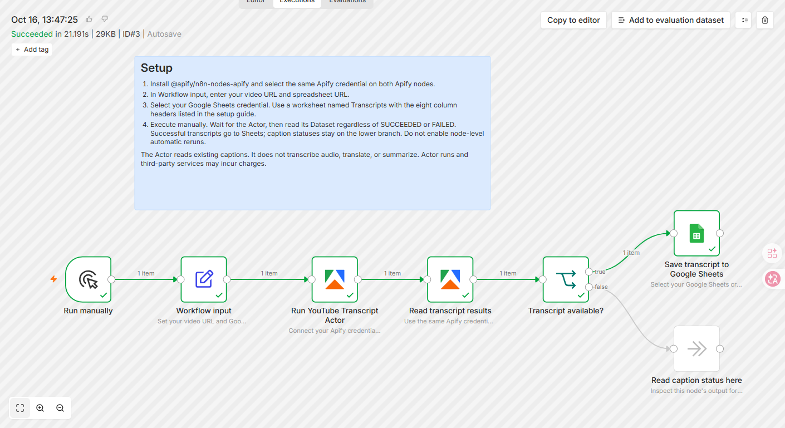
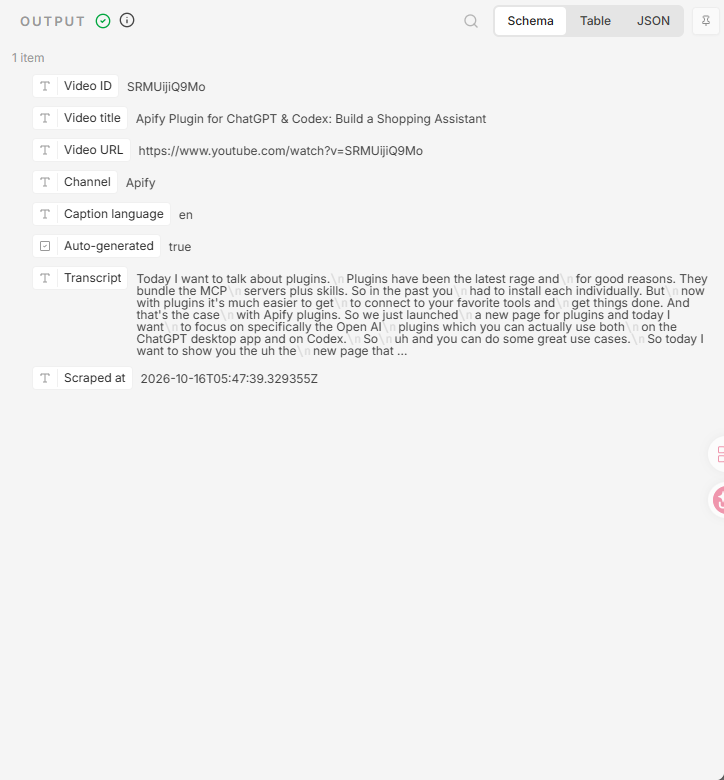
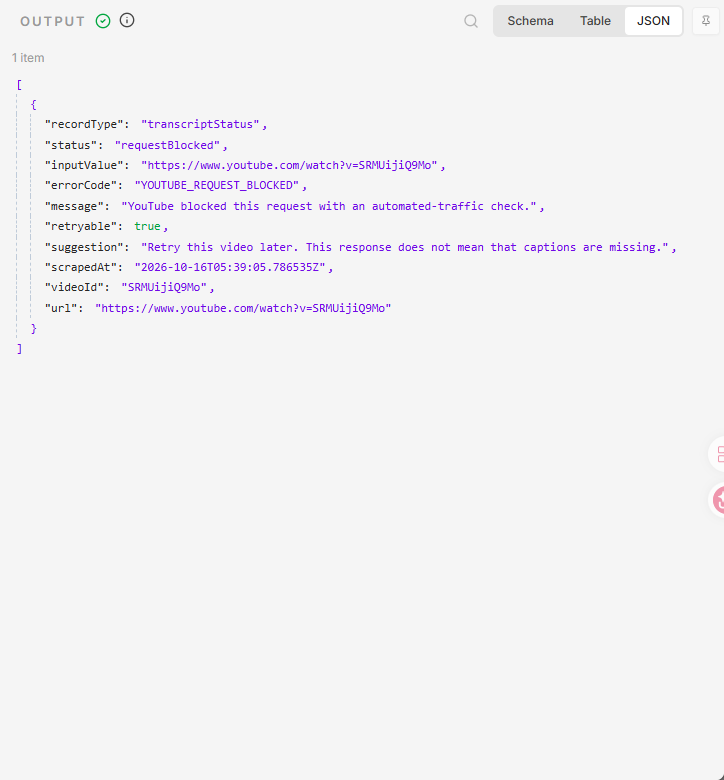

# Save YouTube transcripts to Google Sheets with n8n

Enter one public YouTube video or Shorts URL. This workflow runs [YouTube Transcript Scraper](https://apify.com/arjun_code/youtube-transcript-scraper), retrieves one selected existing caption track, and appends its full text and basic video information to Google Sheets.

Use it to collect caption text for research notes, content review, or a later LLM workflow. It saves captions, not an AI summary, so you keep the source wording and video reference together.

## Quick start

Download [`workflow.json`](https://raw.githubusercontent.com/arjun-go-go/apify-workflow-examples/main/youtube-transcripts-to-google-sheets/workflow.json), import it into n8n, and connect your own Apify and Google Sheets accounts. To save the file, use your browser's **Save page as** and keep the `.json` extension. Set the video URL and destination spreadsheet in **Workflow input**, then click **Execute workflow**. Follow the setup steps below for the exact worksheet headers and credentials.

The workflow file has no separate fee. Actor runs are paid; see [Costs](#costs) before executing. No video recording or speech-to-text service is needed.



The screenshot records the verified execution before a documentation-only canvas-note update. The importable template has the same functional nodes, connections, and output mapping, with an expanded setup note.

## Requirements

- An n8n Cloud or self-hosted instance.
- The official `@apify/n8n-nodes-apify` community node. This workflow targets its v0.8.0 interface and Apify node version 2.
- Your own Apify account connected in n8n through an Apify API credential, or Apify OAuth2 on n8n Cloud.
- Your own Google Sheets credential saved in n8n, with access to the destination spreadsheet.
- A public video with available captions.

## 1. Prepare the destination

Use a dedicated spreadsheet and a worksheet named `Transcripts`. Put these exact headers in row 1, from column A to H:

| Video ID | Video title | Video URL | Channel | Caption language | Auto-generated | Transcript | Scraped at |
| --- | --- | --- | --- | --- | --- | --- | --- |

Alternatively, copy the following tab-separated line and paste it into cell A1:

```text
Video ID	Video title	Video URL	Channel	Caption language	Auto-generated	Transcript	Scraped at
```

The Google account authorized in n8n must be able to edit this spreadsheet. Connecting Google Drive to an assistant does not automatically create a Google Sheets credential in n8n.

## 2. Import the workflow

1. Install the Apify node if it is not already available. In n8n Cloud, search for Apify in the node panel. For self-hosted instances, use **Settings > Community Nodes > Install** and enter `@apify/n8n-nodes-apify`.
2. Open an empty workflow. From the canvas workflow menu, choose **Import from File** and select [`workflow.json`](workflow.json).
3. Open **Workflow input**. Change `videoUrl`, paste the destination spreadsheet URL into `spreadsheetUrl`, and set `sheetName` if you renamed the worksheet.
4. Open **Run YouTube Transcript Actor**. The template defaults to **Apify API** authentication: create or select your Apify API credential. On n8n Cloud, you may instead change Authentication to **Apify OAuth2 API** and connect your account. Set **Read transcript results** to the same authentication method and credential. Do not paste a token into Input JSON or the shared workflow file.
5. Open **Save transcript to Google Sheets** and select your Google Sheets credential.

## 3. Execute manually

Click **Execute workflow**. The first Apify node starts the Actor and waits for a terminal run status. The second reads that run's Dataset, including caption status records from a FAILED run. A successful caption record follows the upper branch and adds one row to the spreadsheet. Open column G to read the fetched caption text.

The manual trigger does not enable a schedule. Repeating the workflow starts another paid Actor run and appends another row. This example deliberately implements a single-video, append-only workflow.

### Verified example

On October 16, 2026, the workflow retrieved the English caption track for [this Apify video](https://www.youtube.com/watch?v=SRMUijiQ9Mo) using Actor 0.1.14. It saved all **7,038 characters** to one spreadsheet row. Reading the row back confirmed that its text matched the Actor's returned caption text exactly. The complete n8n execution took **21.191 seconds** in this example; execution time varies with network conditions and caption availability.

Two cloud runs processed three video inputs across two distinct videos, including automatic and manual English captions. All three inputs succeeded. This small functional check is not a production success-rate estimate. The [verification summary](examples/verified-results.json) records the scope without exposing private execution or spreadsheet links.

A separate check replayed metadata from a real blocked Actor run and read its existing Dataset. The `requestBlocked` record followed the status branch without writing to Sheets or starting another Actor run. This was a replay of an actual failure, not another live blocked-video request.



This is the Google Sheets node's write-result view in n8n. Its caption preview is shortened by the interface; the complete saved text was checked separately. The personal spreadsheet is not shared by this example.

## Output mapping

| Sheet column | Actor field | Meaning |
| --- | --- | --- |
| Video ID | `videoId` | YouTube content identifier |
| Video title | `title` | Title, when supplied by YouTube |
| Video URL | `url` | Canonical watch URL |
| Channel | `channelName` | Publishing channel name |
| Caption language | `languageCode` | Language actually returned |
| Auto-generated | `isAutoGenerated` | Whether YouTube marks the track as automatic captions |
| Transcript | `transcriptText` | Complete fetched caption text, with line breaks |
| Scraped at | `scrapedAt` | UTC extraction time |

The Actor still returns its normal video metadata. Only the fields relevant to this spreadsheet are mapped. `includeSegments: false` omits the timestamped segment array but does not shorten full text or reduce YouTube requests. No SRT/VTT files are requested in this example.

See the [real output excerpt](examples/output-excerpt.json) for selected fields. Its text is shortened only for documentation; the workflow uses the complete `transcriptText` returned by the Actor.

## Caption statuses and limitations

Records such as `noTranscript`, `languageUnavailable`, and `requestBlocked` follow **Read caption status here** instead of being saved as successful transcripts. Inspect the record's `errorCode`, `message`, `retryable`, and `suggestion`. A FAILED Actor run can still provide its saved status record to this branch. A completed n8n execution therefore does not by itself mean a transcript was retrieved: check which branch received a result. Authentication errors, an unavailable Apify API, or failure to start the Actor still stop the workflow; they are not treated as missing captions.

Do not enable **Retry On Fail** on the Actor node. The Actor already uses bounded request retries, including one new-session retry if its fallback request is blocked. Restarting the whole Actor would add another start event and could duplicate successful spreadsheet rows.

For a concrete example, see the [real blocked-request status](examples/status-example.json). A status record is not an empty transcript and does not trigger the successful-transcript event.



- The Actor reads existing captions. It does not transcribe audio, translate, or produce AI summaries.
- `auto` selects the video's default caption language using the available YouTube metadata. It is not audio-language detection.
- A complete fetched caption track can still contain recognition errors or omit speech in the original video.
- The template does not trim long text. Extremely long captions may exceed Google Sheets' cell limits; use a document or file destination for those videos.
- Video access and caption availability can change.

## Costs

The template itself has no separate fee. The price snapshot checked on **October 16, 2026** is **$0.002 per successfully saved transcript** plus **$0.00005 per Actor start** at this workflow's 512 MB setting. One successful single-video run therefore costs **$0.00205** in Actor events at these rates. A run returning only a caption status does not trigger the transcript event, but the start fee still applies. Check the [current Store pricing](https://apify.com/arjun_code/youtube-transcript-scraper) before running; this guide does not lock future prices.

The workflow's one-video example uses a $0.01 maximum event charge, 512 MB memory, and a 180-second Actor timeout. These are run options, not Actor input parameters. n8n and Google services may have their own charges or plan requirements. Own-account developer runs are not evidence of what an external customer was billed.

## Common questions

### Does this workflow create transcripts from audio

No. It retrieves an existing YouTube caption track. A video without available captions produces a status record instead.

### Can I choose English rather than automatic language selection

Yes. In the Actor node's Input JSON expression, change `languages: ['auto']` to `languages: ['en']`. Set `fallbackToAnyLanguage: false` if another language must not be substituted. If that track is unavailable, inspect the status branch.

### Why does the sheet show only the beginning of a transcript

A cell's visible preview is smaller than its stored text. Open the cell or formula bar to inspect it. The workflow does not intentionally trim `transcriptText`; extremely long tracks may exceed Google Sheets' cell limit.

### Does this example save SRT or VTT files

No. This template requests plain caption text with `subtitleFormats: []` and does not write subtitle files to Drive. The Actor supports optional subtitle file exports separately.

### What happens when I run the same URL again

It starts another Actor run and appends another row if successful. This template does not deduplicate the spreadsheet or add a schedule.

## References

- [Apify node installation and authentication](https://docs.apify.com/integrations/n8n)
- [n8n workflow import/export](https://docs.n8n.io/build/manage-workflows/export-and-import.md)
- [Actor documentation and pricing](https://apify.com/arjun_code/youtube-transcript-scraper)

Independent example by Arjun AI. Not affiliated with YouTube or Google.
